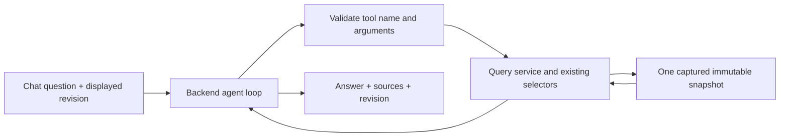

# Data retrieval agent — implementation handoff

Updated 14 November 2026. This document records the architecture discussed with the user and the next implementation task. **The function-calling retrieval agent is proposed, not implemented yet.** The data pipeline and existing context-based chat are implemented.

## User intent

Build an API agent on top of our data so users can ask questions in chat, and the agent can request the relevant observations, histories and comparisons before answering. Example: “Explain why Helsinki is so far behind in screenings.”

The intended flow is: question → model requests a named function → backend validates and executes it against a published snapshot → results return to the model → answer with measurements, periods and sources. The model does not browse arbitrary folders or execute generated code.

## Current system

- Workspace: `/Users/rasmussorri/Desktop/Junction2026`. Existing React/Vite frontend and Express/Node.js backend, normally at `http://localhost:5173`.
- File-based storage, no database or live spreadsheet. `data/dataset.json` is the canonical schema-v2 snapshot; the server loads it into memory. Raw research and immutable downloaded source releases live under `research/`.
- The dataset has 22 counties, 12 strategy goals, county observations, separate national/provider observations, source registry, goal definitions and coverage. Missing values stay null. Observations carry DIRECT/INDIRECT classification, period and provenance.
- Five goals have county measurements: screening, prevention, survival, mortality and treatment. Only screening currently has a complete county target assessment. Supporting measures must not create target achievement.
- `server/index.js`: `/api/data`, `/api/data/status`, allowlisted `/api/evidence/:id`, and `/api/chat`.
- `server/data-store.js`: validated immutable snapshots, atomic publication, archived evidence, persistent recovery and rollback.
- `src/data-contract.js`: assembly, validation and derived coverage.
- `src/metrics.js`, `src/goals.js`, `src/observations.js`: shared selectors, screening arithmetic, assessments, provider coverage and source selection.
- `server/chat-context.js`: currently constructs a fixed scoped context with selected-county observations, selected-goal national/shared context, programme peers and relevant evidence.
- `server/ai.js`: currently calls Gemini with text context and optional Google Search. It does not yet execute custom data functions. Its response parser expects a textual answer, so tool-only intermediate responses require explicit handling.
- Chat requests already carry the displayed revision. A mismatch returns 409 before calling Gemini. Preserve this behavior.

See [data operations](data-operations.md) and [the model audit](data-model-audit.md) for the implemented pipeline. Latest completed verification in this thread: 48 tests, offline consistency check, production build, browser checks, and real rollback/restore passed. One parser-timeout test run failed transiently; focused and full reruns passed. Live Gemini answers were not verified in this work; earlier testing recorded a provider-credit error, so confirm current availability rather than assuming it remains blocked.

## Recommended architecture

Use one read-only agent in the existing Node.js backend. Keep storage as JSON for now. Introduce a deterministic query service shared by agent tools and any future data-query endpoints; avoid a second set of calculations in the AI layer. Internal tool execution can call this service directly, without an HTTP round trip to the same server.

Proposed tool surface:

| Tool | Purpose |
| --- | --- |
| `list_metrics` | Discover metric IDs, definitions, scope, available periods and coverage. |
| `get_observations` | Retrieve chosen metrics for counties, Finland or providers, optionally including history. Support batched region/metric selections. |
| `compare_regions` | Compare compatible observations using deterministic arithmetic and explicit comparison rules. Return exclusions and reasons. |
| `get_goal_assessment` | Return target status, available supporting evidence, and why the target can or cannot be assessed. |
| `get_sources` | Return source metadata and revision-qualified evidence links for retrieved observations. |

Suggested modules: `server/data-query.js` for pure query functions; `server/agent-tools.js` for schemas and dispatch; `server/data-agent.js` for the bounded model/tool loop. These names are proposals, not files that already exist.

## Required behavior

1. Capture one validated snapshot at request start and use it for every tool call and the final answer, even if an import publishes a newer revision during the request. Check the browser revision against that captured snapshot first.
2. Validate tool names, metric IDs, region IDs, requested periods and scopes. Use an explicit allowlist; no arbitrary SQL, filesystem paths, URLs, JavaScript or Python execution.
3. Return structured observations with stable IDs, values/nulls, units, periods, geography, DIRECT/INDIRECT relation and source references. Include the revision and meaningful missing-data reasons.
4. Compute gaps, rankings and assessments in code. Compare only compatible periods, programmes, cohorts and geography. Provider queues, national totals and county residents are distinct scopes. HUS is shared provider context, never five copied county values.
5. Derive source links from returned evidence records. Preserve observation-to-source attribution rather than relying on the model to invent citations.
6. Bound tool rounds, total calls, result sizes, elapsed time and conversation size. Batch independent requests. A reasonable initial limit is three tool rounds, with a separate total-call cap. Cache deterministic query results by revision and normalized arguments where useful.
7. Keep acquisition/publication outside the chat agent. Chat cannot modify metric values, refresh sources, publish snapshots or roll back data.
8. Preserve optional external research as a distinct source of evidence. Verify support for combining custom functions and Google Search in the configured Gemini model/API; if necessary use a separate bounded research step. External search must not silently overwrite local observations.
9. No vector database is needed for structured measurements. Document retrieval for reports can be added later if justified.

Gemini supports function calling; the server must execute requested functions and return function responses. Consult [the official documentation](https://ai.google.dev/gemini-api/docs/function-calling) when implementing the current API protocol, including conversation parts/signatures. Do not assume the existing text-only message conversion preserves tool exchanges.

## Example: “Why is Helsinki so far behind in screenings?”

First check the premise. Retrieve Helsinki's breast, colorectal and cervical observations, target, matching county comparisons and any available comparable history. State the comparison basis: below the strategy target and below other counties are different claims.

The published snapshot has Helsinki breast-screening participation of 74.3% in 2024, 5.7 percentage points below the 80% target. Retrieve this from the snapshot; do not embed the numbers in the agent's instructions.

These data establish a measured gap, not its cause. The answer must explain what the numbers show and explicitly say when the causes are not established. Invitation delivery, appointment access, language barriers or population composition are possible research questions, not findings inferred from participation rates.

If web research is enabled, distinguish documented Helsinki findings, evidence from other populations and hypotheses for local investigation. Never present correlations or plausible narratives as proven causes. Do not infer a trend from a single annual observation.

## Implementation sequence and acceptance checks

1. Implement and test the pure query service against saved snapshots. Include batching, discovery, missing values, history, provider coverage and invalid arguments.
2. Add tool declarations and validated dispatch. Reuse existing assessment and metric functions.
3. Implement the bounded Gemini function-calling loop and connect it to `/api/chat`, preserving revision checks, cancellation, concurrency limits and existing web-research behavior.
4. Return the answer, revision and structured evidence references in the existing frontend response contract; extend the UI only where needed for source attribution or retrieval status.
5. Test model/tool orchestration with mocked model responses: tool-only responses, invalid calls, repeated calls, exhausted budgets, upstream errors, and refresh during an active request.
6. Evaluate representative questions: Helsinki screening comparison; a missing NPS question; HUS coverage; prevention proxies versus prevented cancer cases; mixed-period comparisons; causal “why” questions. Each must produce correct evidence or an explicit limitation.
7. Run `npm test`, `npm run data:check`, `npm run build`, then browser/API smoke tests. A live model smoke test depends on a working funded key; do not claim it passed based only on mocks.

## Working constraints

The user previously allowed at most two smaller-model subagents; avoid unnecessary delegation. Other work has edited the frontend and goal catalogue concurrently, so inspect current files and preserve unrelated changes. Do not replace the existing layout or restart the project. No database migration, scheduled job or new deployment is required for this agent implementation.
