# Data model and frontend audit

Audit date: 14 November 2026. This review includes weaknesses in the previous implementation, not just missing source data.

## Starting architecture

```mermaid
flowchart LR
  R[Saved research files] --> A[Source adapters]
  A --> S[Screening export]
  A --> M[Mortality export]
  A --> O[Other observations]
  S & M & O --> C[Assembly and validation]
  C --> D[Atomic dataset.json]
  D --> L[Last-valid-snapshot loader]
  L --> API[/api/data]
  L --> AI[Chat: whole dataset plus duplicated fields]
  API --> H[Refresh hook + separate health request]
  H --> UI[React: raw values, hard-coded rules and geography]
```

The atomic publisher, source checksums, explicit nulls, and last-valid-snapshot fallback are useful foundations. However, publishing one JSON file does not by itself create one authoritative data model.

## Findings and implementation plan

| Priority | Finding at audit time | Consequence | Action in this pass |
| --- | --- | --- | --- |
| P0 | Screening lives in both `region.screening` and `region.observations.screening`; mortality is also duplicated. | Two authorities can disagree; consumers choose different shapes. | Canonical API measurements only in observations; retain old standalone files as offline exports. |
| P0 | `goalResult`, programme metrics, JSX and AI instructions repeat 80%, 2024, and claims that no peer passes. | A new period or target can produce a correct number with a false label or assessment. | Shared selectors and snapshot configuration drive calculations and labels. |
| P0 | A generic observation renderer calls every numerator/denominator “waiting patients over 180 days.” | A new ratio can be presented as the wrong clinical metric. | Store count labels with the measure and render them generically. |
| P0 | React hard-codes the five counties served by HUS; source-link collection excludes shared provider context. | Geography and provenance depend on which consumer renders the value. | Provider ID, goal and coverage move into data; one selector includes provider evidence. |
| P1 | Missing county measurement, national-only evidence, a proxy and an incomplete benchmark are collapsed into “unknown.” | The user cannot tell whether data is absent or the target is unassessable. | Shared goal view exposes separate availability and assessment reasons; county panel summarizes actual data. |
| P1 | Chat sends the entire snapshot plus duplicate fields for every question. | Unnecessary model cost and distraction from the selected area. | Build a bounded context with selected-area observations, selected-goal national/shared context, programme peers and relevant sources. |
| P1 | Chat does not send the revision visible in the browser. | After an import, an answer can discuss a different dataset from the cards. | Require a matching data revision before any model call; return revision on answers. |
| P1 | Data and reload health are fetched in separate requests; no fetch timeout or client contract check. | A hung request blocks refresh; data and its health can describe different moments. | Return reload state with the data response; validate at the client boundary and bound fetch duration. |
| P1 | Same-data polling still replaces React state. | Unnecessary rerenders and incidental UI state churn. | Reuse loaded state when revision/import time and health are unchanged. |
| P1 | Validation assumes nested objects/arrays are well formed and trusts generated coverage. | Malformed inputs can throw opaque TypeErrors; forged/stale coverage can pass. | Structural guards, derived-coverage validation, metric semantics and geography tests. |
| P2 | Dates, filenames, queue snapshot selection and some mappings are fixed inside source adapters. | New source releases still require adapter work; import is not remote refresh. | Keep snapshot selections explicit; document source-refresh work separately. Do not pretend an import retrieved new data. |
| P2 | There is no source acquisition scheduler or durable snapshot history. | Refreshes are manual; fallback survives only in the running process. | Document follow-up work; no database or scheduler is required for this 22-area local app today. |
| P2 | NPS, county TNM I–II, complete survival benchmark and research/trial outcomes are missing. | Better plumbing cannot make those targets assessable. | Preserve missingness; no replacement with misleading proxy targets. |

## Execution sequence

1. Introduce schema v2 with canonical observations and provider coverage; unify measure selection and screening calculations.
2. Connect the county panel, reports, peers, ratio labels and evidence links to the shared model.
3. Add compact, revision-checked chat context and a coherent, timeout-bounded frontend data load.
4. Harden contract validation; test varied periods/thresholds, absent data, malformed inputs, shared-provider geography, revision conflicts and refresh failures. Import, build and inspect the running UI.

Existing layout and unrelated user edits are preserved. The strategy catalogue expanded to 12 entries while this work was in progress; validation and counts follow the catalogue rather than assuming eight goals or four groups.

## Implemented architecture

```mermaid
flowchart LR
  R[Saved research + explicit source adapters] --> A[Schema v2 assembly]
  A --> V[Structure, provenance, geography, ratios and coverage validation]
  V --> D[Atomic canonical snapshot]
  D --> L[Validated immutable revision + fallback state]
  L --> API[Data + revision + reload state + capabilities]
  API --> C[Client validation + timeout + map join]
  C --> SEL[Shared goal and programme selectors]
  SEL --> UI[Map, county panel, report, peers and evidence]
  L --> CTX[Scoped chat context using the same selectors]
  UI --> REV[Revision checked before model request]
  REV --> CTX
```



Implemented P0/P1 items:

- Canonical snapshots no longer include `region.screening` or a second mortality store. Source-format adapters and offline exports remain available for reproducibility.
- `screeningObservation`, `metrics`, `goalResult`, and `goalView` connect observations to assessments, programme gaps, peer selection and county summaries. Reports and peers use the snapshot year/target. Missing values stay null; peer comparisons require the same period.
- Provider observations include `providerId`, `goalId`, and `coveredRegionIds`. Shared sources are included in evidence links. Ratio labels and survival strata are carried by data.
- County summaries distinguish actual measurements, supporting data, national-only context and missing sources. Unknown target status is not used to hide measured values.
- The data API returns snapshot state and capabilities coherently. Client requests time out after 15 seconds, validate the dataset/map contract and retain existing data after refresh failure. Unchanged payloads retain React state.
- Chat requests require the displayed revision; mismatch returns 409 before Gemini is called. Answers identify their revision, and earlier answers are marked when data changes. Saved-evidence links also carry the revision and reject stale citations.
- Chat receives selected-area observations, selected-goal national/shared context, screening peers and relevant sources. Measured context sizes are roughly 18–19 KB versus a roughly 150 KB full snapshot, before the old duplicate context fields (about 87% smaller).
- Validation now reports structured issues for malformed nested containers, invalid periods, forged coverage, inconsistent metric semantics, duplicate records and invalid provider coverage. A zero denominator can remain explicitly unavailable, but cannot produce a numeric percentage.

Verification: 36 automated tests, source/published consistency check and production build. Browser/API checks cover Helsinki screening and county summaries, HUS context for Itä-Uusimaa, source links, schema v2 delivery, and stale chat/evidence revision rejection without spending AI credits.

## Follow-up implementation — completed 14 November 2026

Source manifests, live refresh adapters, durable archives and rollback are now implemented. Prevention data was also acquired from Sotkanet and connected to all 22 counties. See the [operations runbook](data-operations.md) for commands, validation rules, recovery behavior and verification. The final suite has 48 passing tests.

The original follow-up list below records the audit recommendations; items 1 and 2 are now complete for screening, mortality and prevention. Recurring scheduling, archive pruning and further source adapters remain separate work.

## Original follow-up recommendations

1. Source release manifests and explicit refresh adapters, beginning with mortality and screening. The existing import replays files; it does not contact publishers.
2. Durable revision archives and a rollback command before deployment beyond this local demo. Current fallback is in memory, not a historical database.
3. Acquire the missing outcome/benchmark data and define target-specific assessors only when the cohort, denominator, period and geography match. Supporting indicators must never auto-pass a strategy target.
4. Consider splitting summary/detail endpoints if dataset size grows substantially. At 22 areas, one validated snapshot is reasonable; duplicating it into every AI request was not.
